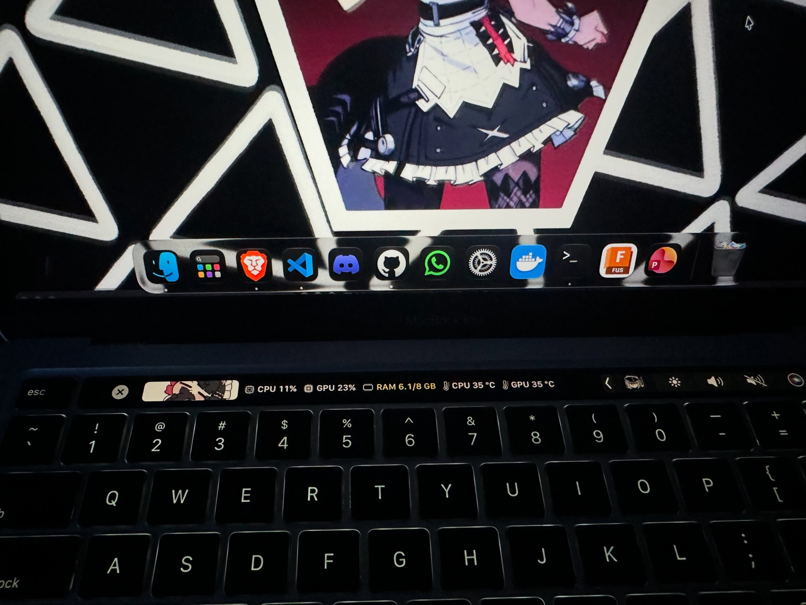

# TouchBarStats

Touch Bar app (MacBook Pro M1) showing CPU, GPU, RAM, temperatures, fan speed and Claude usage.
It lives in the Control Strip; tapping its icon opens the detail bar.

## Settings (no recompiling)

⏲ icon in the menu bar → **Settings…** (or open the app again from Applications).
Everything applies instantly and is saved to `~/Library/Application Support/TouchBarStats/settings.json`:

- **Detail bar**: checkboxes to show/hide each item and arrows to reorder them.
- **Control Strip icon**: image, GIF or video (looping, muted).
- **Animation in the bar**: a GIF or video as one more item, with adjustable width.
- **General**: sampling interval, menu bar icon, restore defaults, quit.

Chosen files are copied to `.../TouchBarStats/Media/`, so the original can be moved or deleted.

## Structure (by feature)

| Folder | What it does |
|---|---|
| `Sources/App` | Composition root (`main.swift`), `AppDelegate` and the menu bar menu |
| `Sources/Metrics` | CPU/GPU/RAM/temperature/fan readers (`Readers`, `SMC`), data (`Model`), texts and colors (`Presentation`), Touch Bar badge |
| `Sources/FanControl` | Root helper client (`Client`) and its slider bar (`TouchBar`) |
| `Sources/ClaudeUsage` | Claude usage polling (`Model`) and its badge/ring (`TouchBar`) |
| `Sources/Settings` | Settings model + JSON storage (`Model`) and SwiftUI window (`Window`) |
| `Sources/Media` | Frame-by-frame playback of images, GIFs and video (`MediaView`) |
| `Sources/TouchBar` | Control Strip, detail bar, bridge to the private APIs and coordinator |
| `Tools/FanHelper` | Root fan helper (`install.sh` / `uninstall.sh`) |
| `Tools/FanBoost` | Manual test: fan at maximum for 10 s (`run.sh`) |
| `Tests` | Logic tests without XCTest |

## Scripts

Requires only the Xcode Command Line Tools (`swiftc`), no Xcode.

- `./build.sh` — builds, installs in /Applications and opens the app.
- `./test.sh` — runs the tests.
- `Tools/FanHelper/install.sh` — installs the fan helper (once, asks for sudo).

## Notes

- Uses private Touch Bar APIs (the same ones MTMR and Pock use), so it cannot ship on the App Store.
- Claude usage reads Claude Code's own OAuth credentials (read-only) and only lets the `claude` CLI renew its token.
